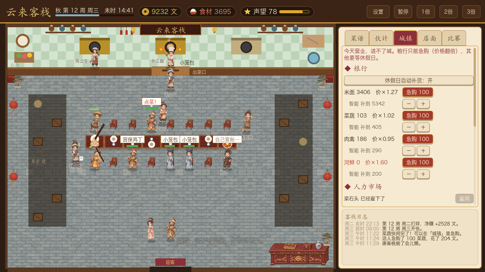
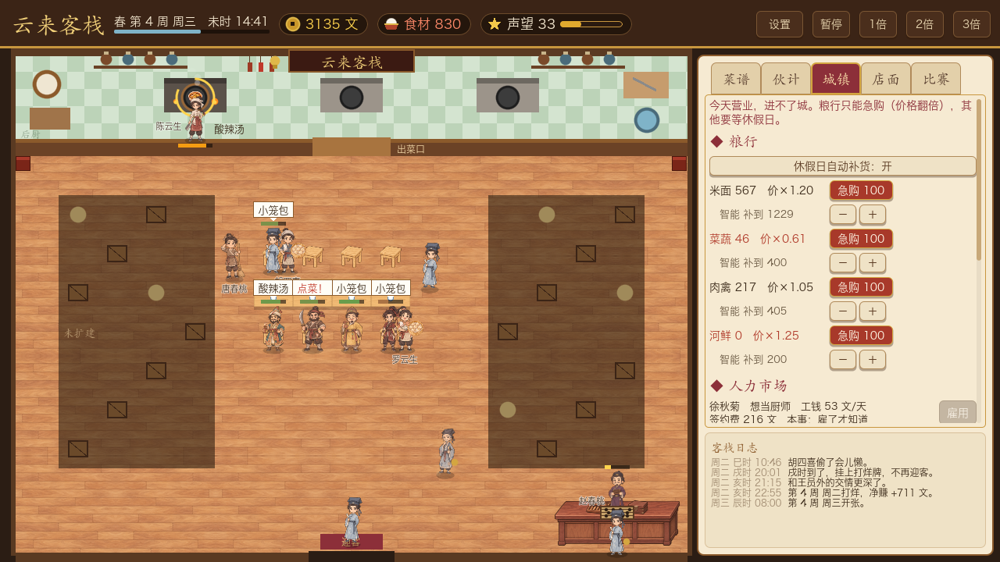

# 云来客栈 · 自动试玩与 Codex 讨论报告（2026-11-14 夜）

## 一句话结论

原来的版本**基本玩不下去**：自动玩家第 4–10 周必破产，客人六七成因为客满走掉，声望一周能掉 40 点。
和 Codex 讨论三轮后修了 8 处，现在 **3 个随机种子都活过 16 周、都赢下 3 场比赛**，第一章在第 3 周完成。
剩下最大的问题是**后期脏桌子没人收拾、伙计 8 人上限卡死产能**，以及 Codex 指出的**营业日没什么可操作的**（玩家容易变成看戏）。

---

## 1. 怎么"玩"的

- 给游戏加了自动玩家：`--play=周数 --seed=种子`。它像普通玩家那样经营：营业日缺食材就急购；休假日按「买桌 → 招人 → 研发 → 升级 → 报名比赛」办事，花完至少留 800 文周转；事件钱宽裕才接。
- 每周打印一行：现金、声望、座位、客流、客满流失率、满意度、章节、比赛、同行声望，以及**分类现金账**（营业、工钱、租金、常规采购、急购本金、急购加价、店面、研发、招人、比赛、事件、税与失窃）。
- 破产就停，不和重开的局混在一起。
- 原始日志在 scratchpad（会话结束会清理），关键数据已摘到下面。

复现：
```
godot --headless --path ~/yunlai-inn --fixed-fps 60 -- --play=16 --seed=1
godot --path ~/yunlai-inn -- --market        # 开局直接进集市看
```

## 2. 三轮实验数据

| | 第 1 轮（原版，无种子） | 第 2 轮（声望/补货/事件修后） | 第 3 轮（再修补货/招人/买桌） |
|---|---|---|---|
| 存活 | 第 9–10 周破产 | 3/3 在第 4–6 周破产 | **3/3 活过 16 周** |
| 第一章完成 | 第 1–2 周（太快） | 第 3–4 周 | **第 3 周** |
| 第 3 周客满流失 | 70% | 34–62% | **21% / 25% / 62%** |
| 食材开销 / 营业 | — | 60–73% | 种子 2 后期约 35% |
| 比赛 | 赢 1 场 | 赢 1–3 场 | **3 场** |

第 3 轮仍有一个种子（种子 3）前 8 周很惨：现金卡在 800–900 文，付不起签约费雇跑堂，客人大量气走，声望掉到 0，第 8 周雇到人后才翻身。

## 3. 发现并已修的问题

| 问题 | 根因 | 修法 |
|---|---|---|
| 声望一周 −40、第一章第 1 周就过 | 每位客人单独加减声望，气走一位 −2 | 改成**每天打烊统一结算**：看当天平均满意度和气走比例，单日最多 +1.2 / −1.5（Codex 给的公式） |
| 开局就买一堆会放坏的菜蔬河鲜 | 自动补货默认四类都补，不管菜单用不用得到 | 只补已解锁菜品用得到的食材，留 800 文周转 |
| 食材开销占营业 60–73% | 补货目标是死数，生意变大后天天两倍价急购 | **智能补货**：按最近三周卖菜实际用量加权预测，看座位变化和节日，每周最多 +35% / −25%；玩家手动调过的那类变「固定」，可点「改回智能」 |
| 天灾每周约 2 次，还打断游戏 | 事件 60%/天，其中 40% 是天灾 | 有选项事件（含官府查店）35%/天弹窗；走水、大雪改为每天 12%、只飘字记日志，不暂停 |
| 第 2 个跑堂迟迟招不到 → 产能卡死 | 人力市场「强塞」逻辑会把跑堂挤出前三 | 按缺口（每 4 座 1 跑堂、每 6 座 1 厨师）先放必需角色，再随机补满 |
| 小店满了也不扩建 | 买桌函数不检查是否真的多出座位，一直买 0 座位的桌子 | 新增座位 ≤ 0 就不算摆得下 |
| 雇来的伙计没有性格、长相全一样 | 雇人时没拷贝 look / trait 字段 | 补上 |
| 摆件立在杂物堆里 | 未扩建区盖住了靠墙那列 | 最靠墙两列不堆杂物 |

## 4. 和 Codex 的讨论纪要（3 轮，Codex 只读）

**第 1 轮**：我认为头号问题是「钱太少、座位太少」。Codex 反对：先别改数值——自动玩家失真（要 1600 文才买一张 200 文的桌子）、账目没分类看不出钱去哪了；声望波动的真根因是单客声望太大，不是天灾；比赛座位门槛别降，6 座根本达不到比赛目标。

**第 2 轮**：Codex 同意默认补货是游戏 bug（真人也会中招）；给出事件分双通道方案和声望公式；定了验收线（第一章第 3–5 周；客满流失第 3 周 < 40%、第 4–5 周 < 25%）；指出我的实验设计漏洞（没有随机种子、多改一起没法归因、破产重开的数据混进来等）。

**第 3 轮**（带着实验数据）：Codex 指出「食材现金/营业」不等于成本率，要把急购加价单独记；反对简单按上周用量补货（节庆、扩建、新菜、放坏都会出问题），给了三周平滑规则；发现**买桌不增座位**的真 bug；判断产能是「前期缺跑堂、后期缺座位」。

**共识**：声望日结、补货要按售出用量平滑预测、人力市场按缺口保证候选人、天灾不打断。
**分歧**：无观点分歧。
**Codex 额外提出、影响乐趣最大的问题**：**营业日缺少主动决策**——六个营业日玩家主要在看伙计干活。建议加低频但有取舍的操作，例如临时主推菜、优先接待某类客人、调整跑堂分工、限量停售。

## 5. 还没修的问题（建议优先级）

1. **后期的「客满」其实是脏桌子没人收拾**（新发现，讨论后截图才看出来）。种子 1 第 12–16 周座位 18→24，但招待一直 ~290/周，客满流失 40–51%。第 12 周截图里长桌上好几个座位空着、摆着没收的脏碗——脏座位不算空位，后来的客人就被当成「客满」打发走了。代码里只要店里有杂役，跑堂就不收拾桌子（`claim_task` 的 `can_clean`），18 个座位全靠 1 个杂役擦。再往后还会撞上伙计 8 人上限（`MAX_STAFF`）。建议：跑堂闲着时也能收拾；杂役按座位数配；扩建时提高伙计上限。

   

   对比第 4 周（8 座、2 个跑堂，客满流失 25%）：

   
2. **营业日加入主动决策**（Codex 提出，玩法方向，需要你拍板选哪种）。
3. **前期现金周转太紧**：种子 3 付不起签约费雇跑堂就一路恶化。可以考虑签约费更低、或第一周给一次「预支」。
4. **智能补货跟不上快速扩张**：每周最多 +35%，座位翻倍那几周仍要急购（种子 1 第 16 周急购加价 3365 文）。可以在座位变化大时放宽上限。
5. **富客没有贵菜可点**：声望高时胡商、千金会来，但只能点已解锁的便宜菜。可以让客人在预算内更偏向贵菜，或让研发提示「富客在找好菜」。
6. **开局的菜蔬 400、河鲜 200 会白白放坏**（开局只有米面菜）。建议开局只给米面。
7. **样本还太少**：3 个种子只能做冒烟测试，定最终数值要 20 个种子以上。
8. **画面**：
   - 客人是站着吃饭的（需要给 15 种客人生成坐姿图）；
   - 桌子下排的客人背对桌子（俯视角正面立绘的限制，可以考虑背影图）；
   - 集市街景还是代码画的。

## 6. 今晚的全部提交（都在本地，没有 push）

```
1e3f399 自动玩家每 4 周截一张大堂（--shots）
0445354 智能补货、急购加价单独记账、人力市场按缺口保证候选人、买桌必须增加座位
aa109dd 声望日结、补货只补用得到的并留周转、天灾改飘字、自动玩家先买桌、--seed、分类现金账
8f9e425 大堂改网格：长方桌拼桌、三档扩建、格子寻路、布置校验走位；雇人带上长相性格；--play / --market
3cefd13 吃饭动画；柜台改木工坊单独购买
e935ba4 走路动画；装入三档桌椅、柜台、地面、灯具、字画美术
2c135f1 结账算盘声
ccc9fa9 桌椅分档、柜台两档、装修换地面灯具、墙上字画、休假日进店布置
ecdd05d AI 美术（人物 26、家具摆件 9、菜 18、立绘 8）；做饭/上菜/结账动画
17afc21 同行经营、三章主线与六种结局、官府与天灾
a10e754 7 种新客人、伙计长相与性格、事件立绘、四位常客
0802bca 一周打烊直接进集市
005c6f3 食材分四类、四季节庆、醉仙楼剧情
d17c78c 存档
1259d6b 修复 Mac 字体空白
```
